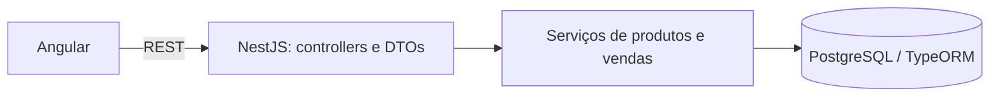

# Sistema Loja Fullstack

Gestão de produtos, estoque e vendas com **Angular, NestJS, TypeScript, PostgreSQL e TypeORM**. Projeto existente aprimorado para portfólio, preservando a interface e o fluxo de trabalho.

**[Abrir demonstração online](https://sistema-loja-fullstack.vercel.app/)**


O GIF registra a interface existente. A demonstração hospedada pode estar em uma revisão anterior às correções deste PR; build/CI não substituem a validação do código publicado. A API gratuita pode demorar ao despertar. Use apenas dados fictícios; a confirmação administrativa não é um acesso público divulgado aqui.

## Problema resolvido e funcionalidades

O sistema organiza o cadastro e a reposição por código de barras, permite pesquisar/ordenar/paginar produtos e registra vendas com baixa de estoque. A venda utiliza preço do servidor e precisa ser inteiramente concluída ou revertida quando um item falha.

- Cadastro e reposição: um código existente soma quantidade e atualiza preço, preservando o nome.
- Edição parcial e exclusão com confirmação administrativa no backend.
- Carrinho com limites visuais de estoque; a decisão final é sempre do servidor.
- Formulários e modais com validação e estados de carregamento, erro, vazio e sucesso.

## Tecnologias e arquitetura

| Camada | Tecnologias |
| --- | --- |
| Interface | Angular 21, TypeScript, formulários reativos, RxJS e SCSS |
| API REST | NestJS 11, TypeORM e class-validator |
| Banco | PostgreSQL, migrations versionadas e código de barras único |
| Qualidade | Jest, Supertest, Vitest e GitHub Actions |
| Hospedagem existente | Vercel (frontend), Render (API) e Neon (banco) |



## Decisões técnicas

- **Vendas concorrentes:** a transação usa `SELECT FOR UPDATE` pelo mesmo gerenciador antes de conferir cada saldo. Produtos repetidos são consolidados e os bloqueios seguem ordem de ID, reduzindo deadlocks. Falha em qualquer item reverte saldos, venda e itens.
- **Reposição concorrente:** `INSERT ... ON CONFLICT` soma a quantidade no PostgreSQL, inclusive quando dois cadastros do mesmo código chegam juntos. O preço da última reposição processada prevalece.
- **Confirmação administrativa:** edição, preço e exclusão exigem `adminPassword` na própria requisição. Configuração ausente/vazia falha de forma controlada; confirmar a senha pela interface não libera endpoints desprotegidos. A senha só fica em memória durante a edição e não é salva no navegador.
- **Validação:** DTOs reais no cadastro e na atualização parcial, código com oito dígitos numéricos e conflito de código retornando 409. Aplicação e E2E compartilham o mesmo ValidationPipe.
- **Persistência:** `synchronize=false`; migrations são executadas explicitamente. Preço é armazenado como numeric e as vendas guardam seu preço por item.

A confirmação por senha compartilhada **não é um sistema de login, identidade de usuário ou autorização empresarial completa**. Não há JWT, sessões ou perfis. A edição manual da quantidade define um saldo absoluto; não é uma operação de reposição. Remover produto pode remover seus itens históricos por cascade, conforme o modelo existente. Estes limites permanecem explícitos.

## Testes e CI

```bash
npm --prefix backend run lint
npm --prefix backend test -- --runInBand
npm --prefix backend run build
npm --prefix frontend test -- --watch=false
npm --prefix frontend run build
```

Os E2E cobrem venda, estoque insuficiente, duas vendas sobrepostas pela última unidade, múltiplos produtos em ordem inversa, rollback, produtos repetidos, reposição concorrente, confirmação administrativa, DTOs e conflito de código. A concorrência usa PostgreSQL real; mocks não certificam bloqueios de banco. O teste frontend confere a confirmação e o envio somente dos campos editados, preservando estoque atualizado por outra operação.

O [CI](.github/workflows/ci.yml) executa lint sem correção automática, testes unitários, E2E obrigatórios e builds. O job cria PostgreSQL 17 descartável, executa migrations e termina com o runner, sem secrets ou banco remoto. O frontend executa Vitest e build Angular. Consulte o resultado de cada commit no [GitHub Actions](https://github.com/guilhermehgl/sistema_loja_fullstack/actions); esta documentação descreve os cenários implementados, não certifica um deploy futuro.

**E2E apagam as tabelas do banco de teste com TRUNCATE.** Só execute em PostgreSQL criado exclusivamente para testes destrutivos. O runner exige conexão loopback, nome terminado em `_test` e confirmação explícita `TEST_DATABASE_ISOLATED=true`; esses controles não transformam um banco existente em descartável. Nunca use Neon ou a URI publicada.

## Executar localmente

Requisitos: Node.js 22.12+ ou 24, npm e PostgreSQL local. Não use o banco publicado.

```bash
git clone https://github.com/guilhermehgl/sistema_loja_fullstack.git
cd sistema_loja_fullstack
npm --prefix backend ci
npm --prefix frontend ci
```

Copie `backend/.env.example` e `frontend/.env.example` para os respectivos `.env`, preservando arquivos existentes. No backend, configure `DATABASE_URL` para seu banco local, `DB_SSL=false`, `CORS_ORIGIN=http://localhost:4200` e uma senha administrativa própria em `ADMIN_PASSWORD`. Não há senha padrão. No frontend use `FRONTEND_API_URL=http://localhost:3000`.

```bash
cd backend
npm run migration:run
npm run start:dev
# Em outro terminal, dentro de frontend:
npm start
```

Frontend: `http://localhost:4200`; API: `http://localhost:3000`.

Para E2E locais, prepare outro banco vazio e descartável chamado `sistema_loja_test`. Defina `TEST_DATABASE_URL` somente para ele e `TEST_DATABASE_ISOLATED=true`, então execute `npm --prefix backend run test:e2e`. O setup não lê o .env da aplicação e gera confirmação administrativa efêmera. O CI já prepara esse ambiente automaticamente.

## API e publicação

| Método | Endpoint | Operação |
| --- | --- | --- |
| GET / POST | `/products` | Listar / cadastrar ou repor |
| PATCH | `/products/:id` | Editar campos enviados + adminPassword |
| PATCH | `/products/:id/price` | Alterar price + adminPassword |
| DELETE | `/products/:id` | Excluir com adminPassword |
| POST | `/products/validate-password` | Conferir password; não cria sessão |
| POST | `/orders` | Registrar venda com items: productId e quantity |

[Backend](backend/README.md) · [Frontend](frontend/README.md) · [Deploy](DEPLOY.md)

Não existe workflow de CD neste repositório. As integrações externas de Vercel/Render possuem automações próprias; push pode criar preview e merge na main pode publicar produção. Alterações do contrato administrativo exigem frontend e backend compatíveis. Publicação definitiva e merge dependem de autorização separada; este PR não executa migrations remotas nem deploy manual.

## Autor

[Guilherme Henrique Guimarães Lima](https://github.com/guilhermehgl)
